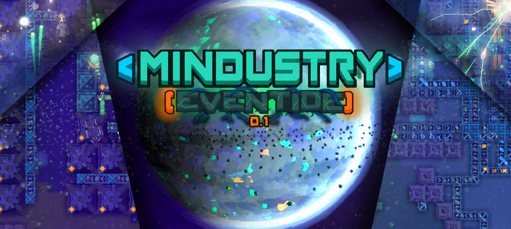

[![Badge Discord]][Discord]

### A world that died, but never stopped living...

Izanami is a cold, dark, and desolate world, full of dangers, but know that it is not evil, it is merely defending itself against those who have invaded it...

## Overview

- New planet: Izanami.
- New items, liquids, blocks, turrets, units and enemies.
- A unique technological progression built around Izanami's resources.
- A new campaign with sectors made specifically for the planet.
- Lore and research revealing the history of the planet.
- A unique power system where electronic machines consume different amounts of energy depending on their function and complexity.

## Mechanics

- **Power consumption:** Every electronic machine requires energy, with consumption varying according to its function and complexity. Even power nodes consume energy.

- **No energy storage:** Power cannot simply be stored for later use. Energy must be continuously generated and distributed throughout your infrastructure. (but I plan to add this in the endgame)

- **The Swarm:** A gigantic hive mind that dwells in the depths of Izanami, representing the final remnants of animal life on the planet and serving as its "antibodies"

- **Umbramycete:** Practically a walking tumor, it crawls and grows across the surface of Izanami, attempting to consume everything in its path.

## Still in development!

Eventide is only at the beginning of its story, there is a lot of content planned to be added in the future. 

- A full campaign
- The Swarm and the Umbramycete, each with their own research trees
- New units, mechanics, and everything else you can imagine

If you would like to contribute to the mod, join our Discord server via the invitation link above.

<!----------------------------------[ Links ]--------------------------------->

[Discord]: https://discord.gg/tUsg6tjQdY
